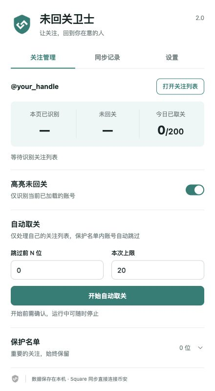

<p align="center"></p>

# X 未回关卫士 2.0.1

在自己的 X 关注列表中识别未回关账号，保护重要关注，并按需同步推文到 Binance Square。

A local-first Chrome extension for X following management, protected accounts, and Binance Square synchronization.

[下载安装包](https://github.com/ingeTreasure/x-unfollow-guard/raw/refs/heads/main/releases/x-unfollow-guard-v2.0.1.zip) · [更新记录](CHANGELOG.md) · [参与开发](CONTRIBUTING.md) · [MIT 许可证](LICENSE)

<p align="center"></p>

*截图使用示例账号和隔离测试数据。支持 Chrome 开发者模式加载，尚未上架 Chrome 应用商店。*


## 2.0 升级内容

2.0.1 额外升级了等待、休息和滚动的随机节奏，详见下方「自动取关」。

- 全新浅色面板与盾形连接 Logo，分为「关注管理 / 同步记录 / 设置」。
- **保护名单**：保存 X 用户名，自动跳过重要账号；运行中修改也会生效。接受空格、逗号、换行分隔，自动去重。
- **参数记忆**：跳过数量和本次上限在输入时自动保存。高亮关闭后仍保留识别统计。
- **跨标签页互斥**：同一扩展只允许运行一个取关任务，关闭任务标签页会释放任务锁；异常退出后最多等待 2 分钟自动过期。
- **更严格的成功判定**：列表节点消失或被复用不再算取关成功；无法确认状态时停止，避免把未核实结果计入已完成。
- **同步记录**：直接查看最近 500 条成功记录，打开 X 原帖或 Square 帖子；不存储推文全文。
- **重复发布保护**：合并同时发起的同帖同步；发布前保存本地待核实记录。超时或后台重启后仍阻止重发，只有人工核实未发布后才可解除。
- **Key 管理**：独立设置页可在非 X 标签页使用，保存后不回显，支持清除。旧版 Key、同步记录、每日计数与高亮开关均沿用原存储键。

### 从旧版升级

若 Chrome 中加载的就是当前文件夹，在 `chrome://extensions` 找到扩展点击「重新加载」，再刷新已经打开的 X 页面。请不要先删除扩展，以免清除本地配置。

若使用 ZIP，先解压后加载其中的扩展目录。不同扩展 ID 的本地数据相互隔离；需要保留原配置时，请在原加载目录更新文件后重新加载。

新权限与主机授权均未增加。完整升级记录见 [CHANGELOG.md](CHANGELOG.md)。

Chrome 浏览器插件，提供三项功能：

1. 在自己的 X「正在关注」列表中直接识别并高亮**没有回关你**的账号，不需要扫描或打开「关注者」页面；
2. 在当前「正在关注」列表中按跳过数量和本次上限自动取关；
3. 一键把当前打开的推文**同步发布到 Binance Square**。

高亮开关、取关额度和 Binance Key 只保存在本机浏览器（`chrome.storage.local`）。X 名单只在当前页面读取；同步时插件直接连接 Binance，不经过中转服务器。

## 安装（开发者模式加载）

1. 下载上方安装包并解压，或克隆本仓库；
2. 打开 Chrome，地址栏输入 `chrome://extensions`；
3. 右上角打开「开发者模式」；
4. 点击「加载已解压的扩展程序」，选择本项目文件夹 `x-unfollow-guard`；
5. 浏览器工具栏出现插件图标即安装成功。

## 使用步骤

### 正在关注列表与未回关高亮

1. 打开 x.com 并登录你的账号；
2. 打开自己的「正在关注」页面；
3. 插件只读取中间主栏的关注名单，不把右侧「推荐关注」混入；没有「关注你」标识的账号会被**红色高亮**，并在「正在关注」按钮左侧紧凑标注「未回关」；角标绝对定位，不占列表行布局空间；
4. 滚动加载的新账号会自动检查。自动取关运行时，面板显示已扫过人数、未回关人数、跳过人数和本次取关人数。

### 自动取关（谨慎使用）

在自己的「正在关注」页设置「跳过前 N 位」和「本次上限」，确认后即可开始。插件只处理当前列表中识别为未回关的账号；即使关闭高亮显示，识别逻辑仍会运行。操作前会滚动到账号并短暂停留，列表按屏幕范围滚动；点击间隔有变化，偶尔会插入较长停顿；2.0.1 起不再按固定人数休息：每次任务随机生成快慢基调，运行中逐渐漂移；操作后的随机等待为 4～55 秒（另加读取页面、点击和确认耗时）。休息按经过的时间和概率触发，一般为 18～65 秒，偶尔为 65～105 秒。滚动按时间和概率触发，距离混合长短步，偶尔小幅回滚，不连续回滚。到达本次上限时立即结束，不再多等一轮休息。X 的逐账号确认弹窗会由插件确认；确认弹窗异常时会停止，也可随时点「停止取关」。每日上限为 200 人。

### 同步推文到 Binance Square

1. 在 Binance 创作者中心获取你的 Square OpenAPI Key；
2. 打开插件面板「设置」页，粘贴 Key 并点【保存 Key】（只存本地）；
3. 保存后，X 推文操作栏旁会出现一个**纯币安图标按钮**；悬停可查看状态/错误；
4. 点按钮会把不超过 2,100 字符的短帖正文和最多 4 张静态图片发到 Square。图片通过 Binance 预签名上传，再附到帖子；
5. 直接视频文件也支持同步，但必须能从 X 读取到 `video.twimg.com` 的直链、视频封面和有效时长；Square 账号还需具备视频发布资格（官方说明为至少 500 名粉丝或白名单）。X 使用 blob/HLS 流或缺少封面时会明确报错，不会悄悄只发文字；视频与图片不能混合在同一条 Square 帖子里。

#### 文本与标签的处理范围

- 正文、换行和 emoji 默认按原文传递；中文 `#话题` 保持原样，不转换成币种标记。同步前会用币安现货公开交易信息识别英文/数字标签中的可交易币种，把符合条件的 `#BTC`、`#ETH` 等按出现顺序转换成 `$BTC`、`$ETH`。每帖最多关联 3 个不同币种：优先保留原文已有的有效 `$币种`，再转换前面可关联的标签；超出的币种标记保留原样并在发布前要求确认、按钮状态中提示。普通英文话题（如 `#DeFi`）和 X 的 `@用户名` 也作为普通文本保留。原文已有的 `$币种` 会校验是否为现货币种，只有有效标记计入可归因币种。币种列表本地缓存 24 小时；网络暂时不可用时最多使用 7 天内的缓存，无法核验时不会发布未经转换的帖子。
- 扩展不猜测普通 `#话题` 的固定上限。如果币安明确返回“话题标签数量超限”，会从正文末尾逐个省略仍保留为 `#标签` 的英文标签后重试；中文标签和 `$币种` 标记不动。成功状态会列出被省略的英文标签；如果币安仍拒绝，会显示接口原文。只有明确的标签数量拒绝才会重试，超时或服务器错误不会自动重发，避免重复发帖。
- 没有可识别币种标记时会先询问是否仍要发帖，避免把没有明显交易归因入口的普通内容误当成收益帖。符合 Write to Earn 资格、点击归因、有效交易和内容质量由币安决定；同步成功不代表一定产生收益。官方当前规则要求读者点击币种标记或交易组件，并在随后 1 分钟内完成符合条件的交易；每帖最多 3 个币种标记。`$BTC` 是可点击币种引用；本扩展当前的 OpenAPI 发帖请求没有单独 K 线图表或 Trade Sharing 卡片字段。Square 原生创作器支持添加图表组件，Trade Sharing 卡需用户选择真实交易；扩展不会编造或代填交易/PnL 信息。需要这些组件时，请在 Square 原生创作器创建并发布该帖。
- X 原帖 ID 与 Square 帖子链接会在本地记录最近 500 条同步记录；重新加载 X 页面后再次点同一条推文，只会打开已有 Square 帖子，不会再次发一份重复内容。币安 504 超时属于结果未知；插件会保存待核实记录并阻止重发，先检查 Square。只有确认未发布后，才可在「同步记录」点击「已核实未发布」解除保护。
- X 的投票、引用/转推关系、原帖链接卡片、图片替代文本、情绪标签和 Binance 交易组件不会迁移。
- Square OpenAPI 图片/视频发布需要正文；纯图片推文会提示无法发布。Square 对外部链接也有限制，包含非 Binance 链接的帖子可能被拒绝，插件会显示 API 错误，不会擅自改写正文。
- 当前只发布 Square 短帖；超过 2,100 字符会在发送前提示，不会转换成长文章，因为长文章需要标题/封面等额外信息。也不复制排版以外的互动数据。

## 面板功能

- **高亮开关**：控制「正在关注」页的未回关标记；
- **自动取关**：按记忆的参数处理未回关账号，自动跳过保护名单，可随时停止；
- **同步记录**：查看已发布或待核实的帖子，跳转原帖和发布链接；
- **同步到 Square**：点每条推文操作栏旁的币安图标；图标不带文字，悬停查看状态或错误。

## 数据与安全说明

- 高亮开关、每日取关计数、Binance Key 均按浏览器本地存储；换浏览器或清除扩展数据后需要重新配置；
- 最近 500 条已同步记录（X 原帖 ID、Square 帖子 ID/链接和币种引用）也只存在本地，用于避免重复发布；清除扩展数据后这层重复保护会重置；
- 插件不会读取、上传任何 X 账号凭证；同步功能只会把你主动点击「同步」的那条推文内容发给 Binance；
- Binance OpenAPI Key 以明文形式存于 `chrome.storage.local`（浏览器扩展的标准本地存储），不会发送到除 `binance.com` 以外的任何地址；如果你和他人共享这台电脑/浏览器账号，请注意该 Key 可能被本机其他扩展或用户读取，请评估风险后使用。

## 开发与验证

运行时使用原生 HTML/CSS/JavaScript，无构建依赖。需要 Node.js 运行逻辑回归测试：

```sh
node --test tests/*.test.cjs
```

界面隔离预览（不访问真实 X 账号或 Binance）：

```sh
python3 tests/preview.py
# 打开 http://127.0.0.1:8766/preview
# 非 X 页面状态：/preview?offline；历史演示：/preview?history
```

测试页只使用浏览器 localStorage 保存演示数据，不会读取扩展真实数据；测试文件不会进入发行包。

Logo 的可编辑源文件为 `icons/logo.svg`；安装开发依赖 `sharp` 后可用 `node scripts/build-icons.cjs` 重新输出图标。`python3 scripts/package.py` 生成安装包，明确排除测试、设计稿及重复备份。

2.0 界面已完成内置浏览器中的交互、440 px / 320 px 排版检查；2.0.1 完成 25 项核心与节奏逻辑回归，包含数千次模拟操作和最长休息的取消验证。**尚未对真实账号执行取关，也未调用 Binance 发帖接口做实发验收**；真实站点 DOM 或接口变化仍需要在使用时确认。详细证据与边界见 `docs/verification.md`。

## 许可证

本项目采用 [MIT License](LICENSE)。X、Twitter、Binance 及其名称和商标属于各自权利人；本项目为独立工具。
